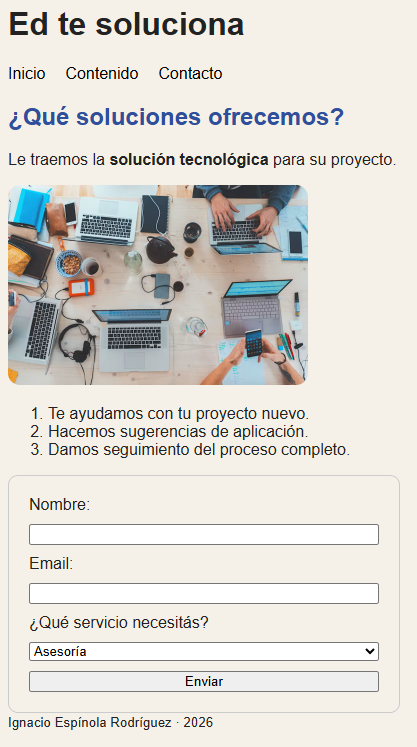

# ed-te-soluciona
TP_Nº1_UTN

## Descripción

Ed te soluciona es una página web desarrollada como trabajo práctico de Full Stack. Utiliza HTML semántico y CSS externo. Incluye un menú de navegación, información sobre los servicios y un formulario para seleccionar el servicio deseado.

## Cómo ejecutar el proyecto

1. Clonar el repositorio ejecutando:

   `git clone https://github.com/ignacio96espinola-beep/ed-te-soluciona.git`

2. Abrir la carpeta `ed-te-soluciona`.
3. Abrir el archivo `index.html` en un navegador.

## Captura de pantalla

## Créditos

- Autor: Ignacio Espínola Rodríguez
- Curso: Diplomatura en Professional Full-Stack Developer
- Módulo 1 - Unidad 1
- Trabajo práctico: Antes de React (Unidad N°1: Antes de React)

## Fuentes y créditos de imagen

- MDN Web Docs - HTML: https://developer.mozilla.org/en-US/docs/Web/HTML
- MDN Web Docs - CSS: https://developer.mozilla.org/en-US/docs/Web/CSS  
- Imagen: Marvin Meyer, Unsplash: https://unsplash.com/photos/SYTO3xs06fU
